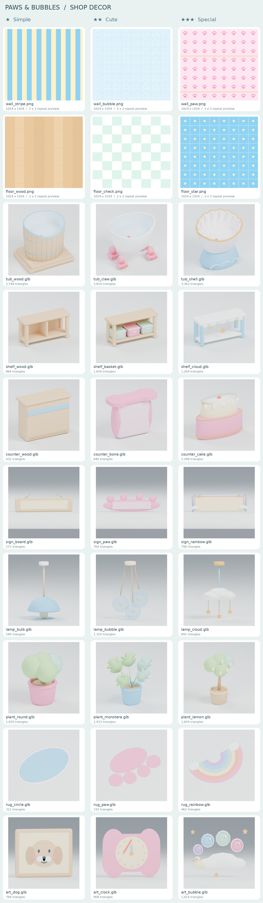
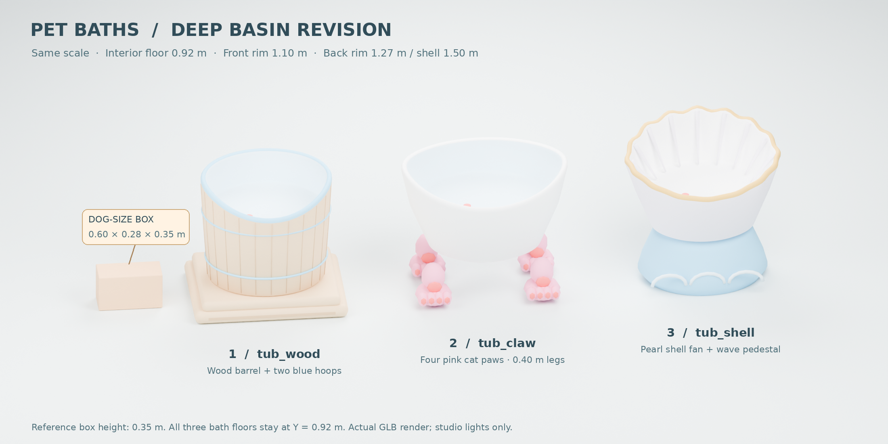

# 멍냥 목욕탕 — 가게 꾸미기 A, 30종

10범주 × ★1 / ★2 / ★3. GLB 24개, 이어 붙이는 표면 PNG 6개, 개별 미리보기 PNG 30장입니다. 모두 직접 만든 메시·색 텍스처이며 제3자 모델·그림·로고를 사용하지 않았습니다.



## 깊은 목욕통 수정 (2026-11-04)



비교 그림은 최종 GLB 3개를 같은 축척으로 다시 불러와 렌더한 것입니다. 옆 기준 상자는 폭 0.60 × 깊이 0.28 × 높이 0.35m이며 미리보기 전용으로, 욕조 GLB에는 들어 있지 않습니다. 개별 미리보기 3장과 위 전체 모음도 새 파일로 교체했습니다.

세 욕조 모두 최종 바이트에서 평평한 바닥 Y=0.92m와 강아지 자리 9개 점의 수직 교차를 확인했습니다. 앞은 약 18cm, 뒤는 약 35cm 깊이이며, 조개의 부채 최고점만 58cm입니다. `validation_tubs.json`에 전체 바닥 범위, 안쪽 넓이, 테두리와 마개 중심 검사 결과가 있습니다. `tub_claw`의 `Stand`는 빈 다리 사이 공간을 남긴 4개의 고양이 발이며, 다리 최고 높이는 0.40m입니다.

재생성: `blender -b --factory-startup --python source/build_tubs.py`, 개별 렌더는 `source/render_previews.py -- tub_wood tub_claw tub_shell`, 비교는 `source/render_tub_comparison.py`를 Blender로 실행 후 `python source/compose_tub_comparison.py`. 최종 규격 검사는 `python source/validate_tubs.py`입니다. 원래 `build_decor.py -- tubs`도 새 욕조 생성기를 사용합니다.

## 납품 파일

| 범주 | ★1 | ★2 | ★3 |
|---|---|---|---|
| 벽지 | `wall_stripe.png` | `wall_bubble.png` | `wall_paw.png` |
| 바닥 | `floor_wood.png` | `floor_check.png` | `floor_star.png` |
| 목욕통 | `tub_wood.glb` | `tub_claw.glb` | `tub_shell.glb` |
| 도구 선반 | `shelf_wood.glb` | `shelf_basket.glb` | `shelf_cloud.glb` |
| 카운터 | `counter_wood.glb` | `counter_bone.glb` | `counter_cake.glb` |
| 간판 | `sign_board.glb` | `sign_paw.glb` | `sign_rainbow.glb` |
| 조명 | `lamp_bulb.glb` | `lamp_bubble.glb` | `lamp_cloud.glb` |
| 화분 | `plant_round.glb` | `plant_monstera.glb` | `plant_lemon.glb` |
| 러그 | `rug_circle.glb` | `rug_paw.glb` | `rug_rainbow.glb` |
| 벽 장식 | `art_dog.glb` | `art_clock.glb` | `art_bubble.glb` |

각 파일의 미리보기는 `<이름>_preview.png`입니다. 표면 미리보기는 2 × 2 반복, 가구 미리보기는 내보낸 GLB를 다시 불러온 Blender 렌더입니다. 미리보기의 조명·바닥·카메라·글자는 GLB에 들어 있지 않습니다.

## 좌표와 연결

- glTF 2.0 바이너리, 1단위 = 1m, Y 위, 정면 −Z. 원점: 바닥 물건은 바닥 가운데, 벽걸이는 뒷면 가운데(Z=0), 조명은 맨 위(Y=0).
- 원목·파스텔·금색 모두 색 텍스처만 사용합니다. GLB마다 128 × 64 PNG 팔레트를 내장하며 노멀/AO/빛 굽기/외부 텍스처 참조가 없습니다. 금색도 금속 맵 없이 색으로 표현했습니다.
- 욕조 (2026-11-04 깊은 욕조 수정): `Stand` / `Tub` / `Plug`, 바닥 가운데 원점, Y 위·정면 −Z. 전체 바닥 범위는 1.6 × 1.1m 이내이며 **강아지가 서는 평평한 안쪽 바닥은 Y=0.92m 고정**입니다. 바닥 안쪽 넓이는 약 1.07~1.10 × 0.95~0.96m입니다. 앞 테두리는 Y≈1.10m, 옆·뒤는 Y≈1.27m로 부드럽게 높아지며 가장자리는 약 5cm 두께로 둥글게 말았습니다. 원목은 낮은 단에 끼워진 세로 판자 통+하늘색 띠 두 줄, 흰 고전 욕조는 상자 없이 높이 0.40m의 통통한 분홍 고양이 발 4개, 진주 조개는 최고 Y=1.50m의 뒤쪽 부채와 금색 테두리·하늘색 물결 받침입니다. 빨간 마개 `Plug` 원점은 실제 마개 중심 (0.18, 0.932, −0.17)입니다. 각 2,748 / 3,816 / 3,362 삼각형으로 4,000 이하입니다. 기존 0.9m 받침 윗면이나 이전 얕은 테두리에 맞춘 충돌 형상을 재사용하지 말고, 강아지 기준 높이 0.92m와 새 메시를 사용합니다.
- 선반: 1.8 × 0.6m, 최고 Y=0.9m. 도구를 놓는 윗면은 평평하고 장식은 그 아래에 있습니다.
- 카운터: 폭 1.2m, 깊이 약 0.5m, 전체 높이 0.95m. 손님 쪽은 −Z입니다. 케이크 카운터는 체리 줄기까지 높이에 포함됩니다.
- 간판: 전체 1.6 × 0.5 × 0.08m, 가운데는 비어 있습니다. ★1 빈 판 약 1.32 × 0.24m / ★2 약 1.08 × 0.21m / ★3 안전한 가운데 글자 영역 약 1.05 × 0.23m. 글자는 별도 개발 노드에서 올려 주세요.
- 조명: 전체 길이 약 0.7m. `Bulb`는 실제 메시 오브젝트이며 빛을 넣을 위치입니다. ★2의 `Bulb`에는 비눗방울 3개 속 전구를 묶었습니다. 실제 광원은 게임에서 연결합니다. ★2 외피는 색 PNG의 알파를 사용하는 반투명 재질입니다.
- 화분: 높이 각각 0.6 / 0.9 / 1.3m.
- 러그: 1.6 × 1.0m, 두께 0.018~0.020m. ★3은 16분할 곡선의 무지개와 흰 구름 패드·술입니다.
- 벽 장식: 전체 0.6 × 0.5 × 0.05m. `Hand_H` / `Hand_M`는 독립 메시이며 시계 가운데를 원점으로 **로컬 Z축** 회전합니다. 장식 그림도 원본 색면 도형으로 제작했습니다.
- 벽지·바닥: 1024 × 1024 RGB PNG, 한 장 = 1 × 1m, Repeat 샘플링. 가로·세로 주요 모티프는 4회 반복합니다(세로 줄무늬는 가로로 4회). 체크 한 칸은 0.25m입니다. 발바닥 벽지는 타일 아래 1/4 시작에 금색 가는 띠가 있습니다.

## 검수

- `validation_geometry.json`: 제작 시 삼각형 예산·크기·부품 원점.
- `validation_contract.json`: 최종 GLB 바이트에서 실제 삼각형, 월드 경계, 텍스처, UV 색상, 지정 이름·회전축과 30개 미리보기 확인.
- `validation_khronos.json`: GLB 24개 모두 Khronos glTF Validator 오류 0 / 경고 0.
- `validation_godot.json`: Godot **4.4.1**, 캐시 없는 별도 프로젝트에서 GLTFDocument로 GLB 24개 파싱·씬 생성, 모든 메시/재질/내장 색 텍스처와 분리 부품·시곗바늘 회전 확인 PASS.

이 납품은 꾸미기 그래픽 파일입니다. 게임의 구매·배치·저장·충돌·광원 연결과 Windows 실기 화면은 이번 검수 범위에 포함되지 않습니다.

## 재생성

`source/`에 모든 제작·검증 소스를 포함했습니다. Python 3(Pillow, NumPy), Blender 4.2, Godot 4.4.1, Node.js의 `gltf-validator`가 필요합니다.

```sh
python source/make_textures.py
blender -b --factory-startup --python source/build_decor.py
blender -b --factory-startup --python source/render_previews.py
python source/compose_previews.py
python source/validate_contract.py
node source/validate_gltf.cjs
```

Godot 검수는 이 폴더를 새 프로젝트에 복사한 뒤 `godot --headless --path <프로젝트> --script res://<폴더>/source/verify_decor.gd`로 실행합니다. PNG 팔레트는 사용자 지정 색의 정확한 sRGB 바이트입니다. 모음 이미지 제목에만 시스템 DejaVu 글꼴을 사용하며 게임 에셋에는 글자·폰트를 넣지 않았습니다.
