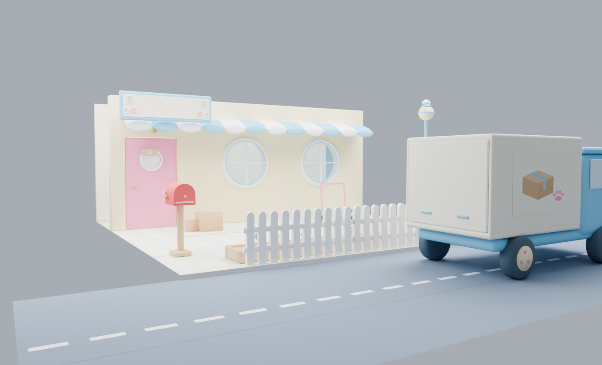
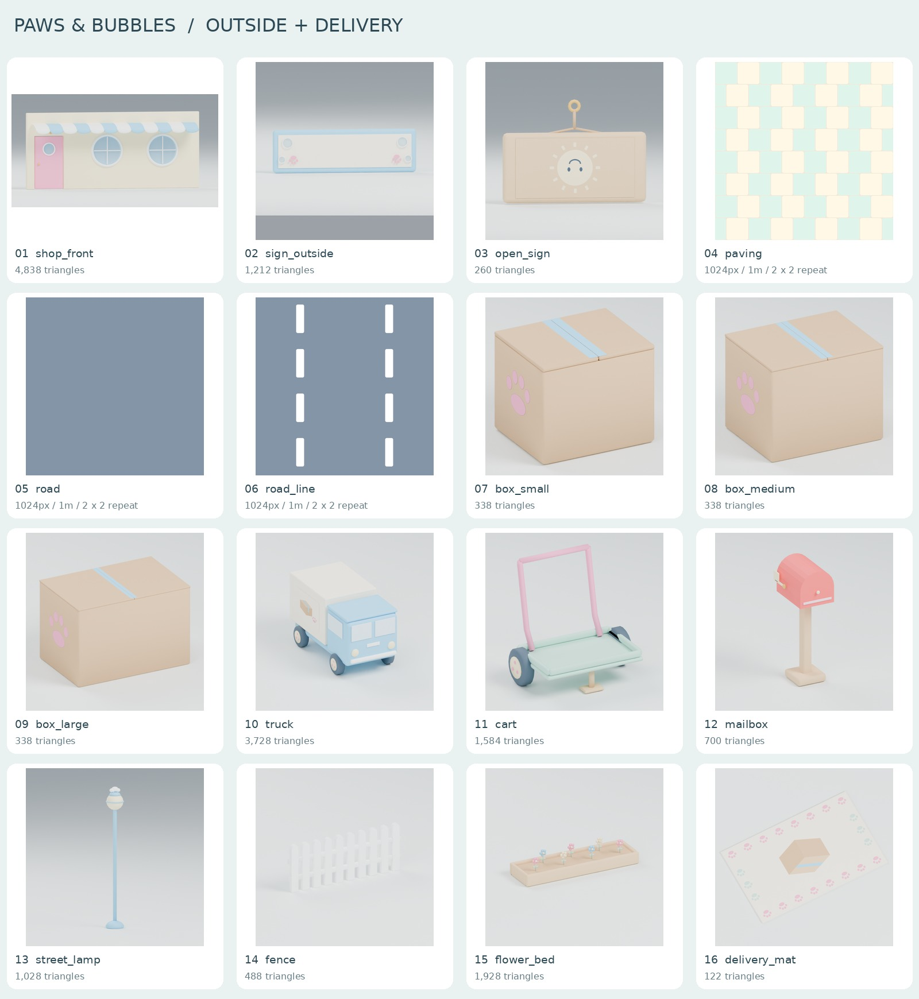

# 멍냥 목욕탕 — 가게 앞 마당·택배 16종

요청 이름의 GLB 13개 + 반복 바닥 PNG 3개, 개별 PNG 미리보기 16장입니다. 이전 도구·꾸미기와 같은 원본 파스텔 색/모델링 방식을 사용했습니다. 외부 메시·그림·로고를 가져오지 않았습니다.



위 이미지는 실제 GLB를 7m 폭 × 5m 깊이 마당에 배치한 참고 렌더입니다. 카메라 눈높이는 1.6m입니다. 도로·중앙선은 1m UV 반복을 적용했습니다. 배경과 내부 바닥·뒷판은 미리보기용이며 GLB에는 포함되지 않습니다. 게임 실행 화면은 아닙니다.



## 파일

| 번호 | 파일 | 검수 삼각형 / 크기 |
|---|---|---|
| 1 | `shop_front.glb` | 4,838 / 벽 자체 7 × 3 × 0.2m |
| 2 | `sign_outside.glb` | 1,212 / 2 × 0.6 × 0.1m |
| 3 | `open_sign.glb` | 260 / 전체 0.35 × 0.25m |
| 4 | `paving.png` | 1024 × 1024 / 1m 반복 |
| 5 | `road.png` | 1024 × 1024 / 1m 반복 |
| 6 | `road_line.png` | 1024 × 1024 / 1m 반복 |
| 7 | `box_small.glb` | 338 / 본체 0.3 × 0.25 × 0.25m |
| 8 | `box_medium.glb` | 338 / 본체 0.5 × 0.4 × 0.4m |
| 9 | `box_large.glb` | 338 / 본체 0.9 × 0.6 × 0.6m |
| 10 | `truck.glb` | 3,728 / 전체 폭 1.8 × 높이 2.0 × 길이 3.5m |
| 11 | `cart.glb` | 1,584 / 짐칸 0.9 × 0.6m, 테두리 높이 0.3m, 손잡이 1m |
| 12 | `mailbox.glb` | 700 / 높이 1.2m |
| 13 | `street_lamp.glb` | 1,028 / 높이 3m |
| 14 | `fence.glb` | 488 / 폭 2 × 높이 0.8m |
| 15 | `flower_bed.glb` | 1,928 / 폭 2 × 깊이 0.6 × 높이 0.4m |
| 16 | `delivery_mat.glb` | 122 / 1.6 × 1.0 × 두께 0.02m |

각 GLB의 `<이름>_preview.png`는 실제 GLB를 다시 불러온 정면·측면 렌더입니다. 바닥 3개의 같은 이름 미리보기는 2 × 2 반복입니다. `qa/`의 PNG와 `overview_motion.jpg`는 부품을 실제 회전시킨 추가 검수 사진입니다.

## 좌표·재질

- glTF 2.0 바이너리, 단위 1m, Y 위, 정면 −Z. 별도 기술하지 않은 자산은 바닥 가운데가 원점입니다.
- 모든 색은 PNG 알베도입니다. 공통 팔레트 128 × 64px, 별도 원본 그림도 PNG 1024px 이하로 GLB에 내장했습니다. 외부 텍스처 경로, 노멀맵, AO맵, 빛 굽기, 뼈대, 내장 애니메이션은 없습니다. 금색 종도 색으로 표현합니다.
- 창문은 하늘색 PNG 알파를 쓰는 반투명 재질입니다. 트럭 운전석 창문은 뿌연 불투명 색면입니다. 게임 조명 아래 유리 투명 정렬은 개발 단계에서 최종 확인해 주세요.
- 움직이는 부품은 각기 독립 메시이며, 원점과 로컬 회전축을 아래 표대로 맞췄습니다. 가로등 `Bulb`는 메시 없는 빈 노드입니다.

## 부품과 열림 방향

아래 각도는 **닫힌 기본 자세에서의 로컬 축 라디안**입니다. 검수용 최종 각도이며 게임에서는 원하는 속도로 보간합니다. 정확한 원점 숫자는 `asset_manifest.json` 및 `validation_geometry.json`에 있습니다.

| 파일 | 부품 | 축 / 예시 각도 | 원점·동작 |
|---|---|---|---|
| shop_front | `Door` | Y / −1.5 | 경첩 (2.02, 0.02, −0.035), 가게 안쪽 +Z로 열림 |
| shop_front | `Bell` | Z / 0.4 | 종 맨 위 매단 곳에서 흔들림 |
| open_sign | `Plate` | Y / π | 원점은 걸이 바로 아래 (0, −0.07, 0), 해 그림↔잠자는 달 그림 |
| box 3종 | `Lid_L` / `Lid_R` | Z / +1.9, −1.9 | 각 바깥 접힘선에서 위·바깥으로 열림. 테이프도 각 뚜껑에 속함 |
| truck | `Wheel_FL` / `Wheel_FR` / `Wheel_BL` / `Wheel_BR` | X / 1.2 | 네 바퀴 축 가운데. L은 −X, F는 −Z |
| truck | `Door_Back` | X / −1.8 | 뒷문 위 경첩, 짐칸 밖 +Z로 들려 열림 |
| cart | `Wheel_L` / `Wheel_R` | X / 1.2 | 두 바퀴 축 가운데, 미는 사람은 +Z에 위치 |
| mailbox | `Flag` | X / −π/2 | 옆 깃발 축에서 위로 올라감 |
| street_lamp | `Bulb` | 빈 노드 | 둥근 등 가운데, 게임의 실제 Light3D 연결 위치 |

## 배치·세부 사항

- 외벽 원점은 벽 아랫변 가운데입니다. 문 구멍은 **+X 쪽** 중심 X=2.6m, 폭 1.2m(X=2.0~3.2), 높이 2.1m(Y=0~2.1)입니다. 정면에서 바라본 화면에서는 왼쪽에 보입니다. 기본 문은 닫혀 있으며 회전하면 고정 벽에 막히지 않는 실제 구멍이 드러납니다. 두 큰 창문도 실제 벽 구멍에 반투명 유리를 넣었습니다. 차양 때문에 외벽 GLB 전체 깊이는 약 0.924m지만 벽 자체 두께는 0.2m입니다.
- 바깥 간판은 뒷면 가운데가 원점(Z=0), 앞은 −Z입니다. 가운데 약 1.25 × 0.36m는 비어 있으므로 게임의 글자 노드를 올립니다.
- 영업 팻말 원점은 맨 위 걸이(Y=0)입니다. 해는 −Z 면, 잠자는 달은 +Z 면입니다. `Plate`에 판과 아래쪽 줄을 함께 묶어 뒤집을 때 줄이 판을 따라갑니다.
- 상자는 밑·옆벽과 내부 바닥을 갖춘 속 빈 구조입니다. 옆 발바닥 도장 평면이 본체보다 0.3mm 돌출하여 전체 폭에 0.3mm가 더해집니다. 테이프는 뚜껑 표면보다 0.01mm 위에 있습니다.
- 트럭 짐칸도 후면이 실제로 열리는 구조입니다. 바퀴·전조등·손잡이를 포함한 전체 외형을 폭 1.8m, 길이 3.5m에 맞췄습니다.
- 수레 짐칸 내부 바닥은 Y=0.24m, 테두리는 Y=0.3m, 손잡이 최고 Y=1m입니다. 바퀴가 바깥에 있으므로 전체 폭은 약 1.058m, 전체 깊이는 손잡이 포함 약 0.775m입니다.
- 울타리는 X 방향으로 **2m 간격** 반복합니다. 양 끝 X=−1,+1m 레일 단면을 일치시켰습니다. 화단도 X 방향 2m 간격으로 이어 놓습니다.
- 바닥 PNG는 1m × 1m 당 UV 1회, Repeat 샘플링을 사용합니다. `road_line.png`는 `road.png`와 바탕색이 같고 이미지 U=0.5 부근에 세로 흰 점선 2개가 반복됩니다. 도로 진행 방향과 텍스처 V 방향을 맞춥니다.

## 검수·재생성

- `validation_geometry.json`: 제작 시 삼각형·크기·각 부품 원점/축.
- `validation_contract.json`: 최종 GLB 바이트에서 16종 이름·크기·예산·내장 PNG·팔레트 UV·부품/축·빈 노드·벽/문 구멍·울타리 끝단 일치 확인 PASS.
- `validation_khronos.json`: GLB 13개 모두 Khronos 오류 0 / 경고 0.
- `validation_godot.json`: Godot 4.4.1, 캐시 없는 별도 프로젝트에서 13개 GLB 파싱·씬 생성·모든 재질/내장 텍스처와 각 관절 회전 PASS. 상자 뚜껑의 위/바깥 열림, 트럭 후문의 뒤쪽 열림, 회전 중 피벗 고정도 실제로 검사했습니다.
- 개별 렌더·뒤집은 팻말·열린 상자/문/짐칸과 1.6m 눈높이 배치를 육안 확인했습니다.

`source/`에 모든 재생성 소스가 있습니다. Python 3(Pillow, NumPy), Blender 4.2, Godot 4.4.1, Node.js의 `gltf-validator`로 실행합니다.

```sh
python source/make_textures.py
blender -b --factory-startup --python source/build_outside.py
blender -b --factory-startup --python source/render_previews.py
blender -b --factory-startup --python source/render_previews.py -- pose box_large shop_front open_sign truck mailbox
blender -b --factory-startup --python source/render_yard.py
python source/compose_previews.py
python source/validate_contract.py
node source/validate_gltf.cjs
```

Godot는 새 프로젝트에 이 폴더를 복사하고 `godot --headless --path <프로젝트> --script res://<폴더>/source/verify_outside.gd`로 검사합니다. 개별 에셋은 알베도만 사용하며 렌더 조명·배경·미리보기 글자는 GLB에 들어 있지 않습니다. 모음 이미지의 글꼴은 시스템 DejaVu입니다.

이번 납품은 그래픽 파일입니다. 게임의 문 상호작용, 택배 생성·들기·내려놓기·개봉 보상, 이동·충돌 및 실제 광원 연결과 Windows 실기 플레이는 별도 개발·확인 범위입니다.
