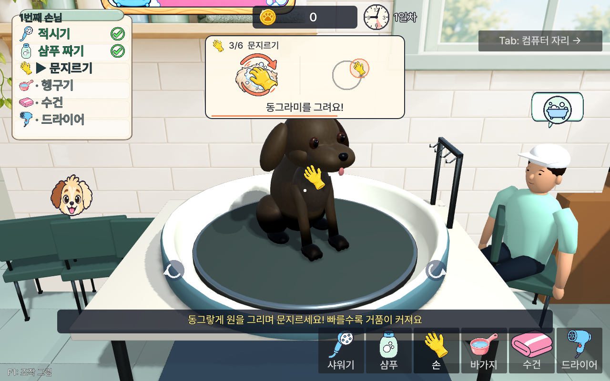
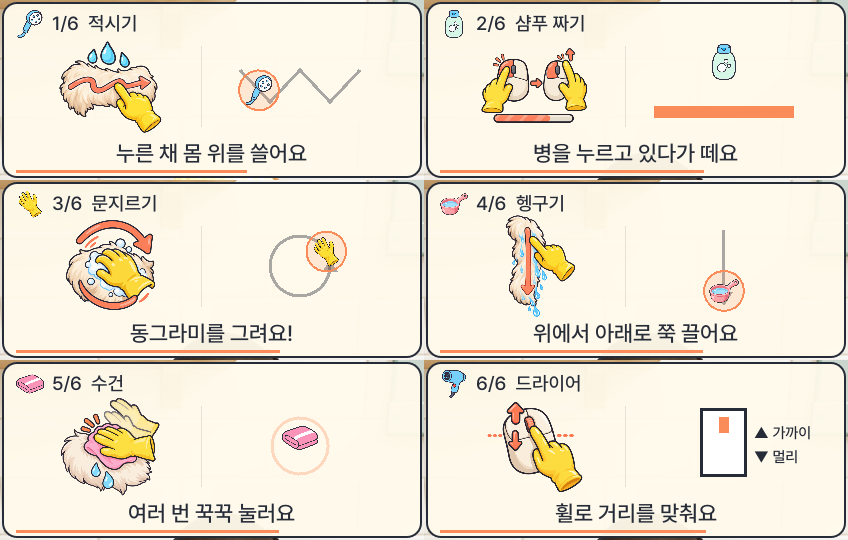
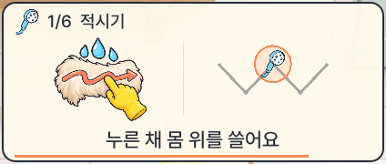

# 목욕 6단계 손동작 안내 그림과 움직이는 시범

2026-10-29 사용자 직접 요청. main `7ffc568`의 UI·게임 규칙을 기준으로 `dev/bath-gesture-art`에 연결했다.

## 납품 파일

모두 `assets/ui/`의 512×512 RGBA PNG다. 배경 알파를 유지하며 글자는 게임에서 그린다.

| 파일 | 글자 없이 구분하는 그림 | 함께 움직이는 시범 |
|---|---|---|
| `hint_wet.png` | 물방울·털·좌우로 쓸어 가는 손 | 기존 샤워기가 지그재그 경로를 이동 |
| `hint_squeeze.png` | 마우스 왼쪽 버튼 누름 → 뗌·차오르는 막대 | 기존 샴푸 병의 누름 표시 + 차오름 → 들어 올림 |
| `hint_scrub.png` | 거품·장갑·원형 화살표 | 기존 장갑이 원을 따라 이동 |
| `hint_rinse.png` | 세로 털·흐르는 물·아래 화살표 | 기존 바가지가 위에서 아래로 이동 |
| `hint_towel.png` | 털 위 분홍 천·장갑 잔상·누름 표시 | 기존 수건의 누름/뗌·퍼지는 물결 |
| `hint_dry.png` | 마우스 휠·손가락·상하 화살표 | 마우스 휠의 상하 이동 (위: 가까이 / 아래: 멀리) |

PNG와 애니메이션을 양쪽에 배치했다. 이전의 `if PNG / else animation` 구조를 없애고 시범은 항상 그린다. PNG가 하나 빠져도 그 단계의 시범을 중앙에 표시한다. 각 단계가 시작할 때 시범 시계를 초기화해 누르기 중간이나 뗌부터 시작하지 않는다. 첫날 첫 손님·단계별 4.5초·한 줄 설명·컴퓨터 자리 숨김은 유지했다. 기존 드라이어 휠 설명이 `wash_station.gd.adjust()`와 반대여서 실제 입력 방향으로 고쳤다.

기존 도구·카드·말풍선·배경 등 PNG **18개 전부 원본과 바이트 단위로 동일**하다. `tool_*` 텍스처를 제목과 움직이는 시범에 재사용하며 가로세로 비율을 보존한다.

## 제작 방법과 출처

내장 `image_gen`으로 서로 다른 프롬프트 6개를 각각 생성했다. 기존 UI의 짙은 둥근 외곽선·노란 고무장갑·하늘색 물·분홍 천을 기준으로 맞췄다. 새 도구 아이콘은 생성하지 않았다. 생성 결과를 ImageMagick으로 512px로 줄였고 알파를 유지했다. 전체 최종 프롬프트·생성 방식·파일 해시·알파 검사는 [BATH_HINT_GENERATION.json](BATH_HINT_GENERATION.json)에 있다.

이번 추가분에 제3자 에셋·유료 모델·폰트를 가져오지 않았다. 기존 자산과 폰트는 원래 출처·라이선스를 유지한다. AI 생성물의 독점 저작권이나 등록 가능성을 보증하거나 기존 파일을 CC0 등으로 재지정하지 않는다.

## 실제 적용 화면

Godot 4.4.1의 실제 게임 씬과 `GuideOverlay`를 렌더링한 화면이다. 촬영 도구는 단계별 그림을 한 번에 검수하기 위해 이전 단계 마스크를 채우고 `_advance()`로 넘기며, 시범 애니메이션은 실제 시간으로 진행한다. 직접 마우스로 목욕을 끝낸 실기 영상은 아니다. 목욕 조작은 기존 `test_wash_flow`, `test_wash_pace`의 흉내 손으로 별도 검사했다.

GIF는 각 단계에서 12프레임씩 뽑은 발췌 루프다. 게임의 4.5초 표시 시간과 GIF 재생 길이는 다르다. [실행 검사·한계·원본 로그](../qa/BATH_HINTS_2026-10-29.md)를 함께 참고한다.
