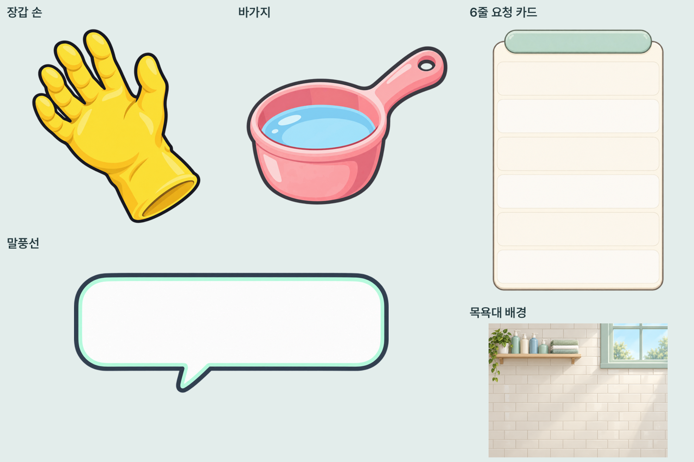
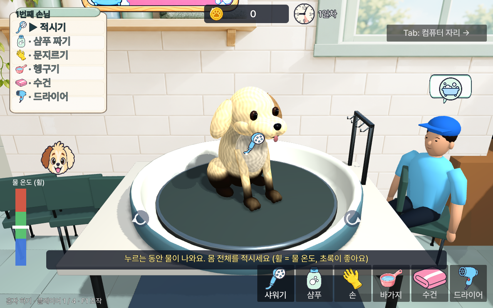

# 볼 관절과 2D 그림 5개 납품

2026-10-27 사용자 요청. 이후 main의 하루 영업·대기 손님 기능을 유지하며 작업했다.

## 강아지

`art/incoming/dog/dog.glb`와 동일한 `assets/models/dog/dog.glb`에 `Cheek_L`, `Cheek_R` 메시를 추가했다. 캐릭터 자신의 좌우이며, `Head`의 자식이고 원점은 볼 가운데다. 기존 통합 볼 볼륨을 별도 메시로 옮겨 얼굴 안에 일부 겹쳐 연결했다. armature와 애니메이션 트랙은 없고 깨끗한 알베도·UV 무겹침을 유지한다. 삼각형 7,686개로 8,000 상한 이내다. 털 메시와 볼록 클릭 판정은 각각 18개다.

기존 `flap_cheeks()`가 새 관절을 찾아 변형하는 것, 털 셰이더 적용, Head 계층을 `test_retail_art`에서 검사했다. 파일 구조·피벗·UV 검사는 `VALIDATION_SLOTS.json`, Khronos 검사는 `VALIDATION_GLTF.json`, 원본/게임 복사본 일치는 `RUNTIME_MANIFEST.json` 참고.

## 2D 그림과 연결

| 경로 (`assets/ui/`) | 크기 | 내용 |
|---|---|---|
| `tool_hand.png` | 512×512 | 투명 배경 노란 고무장갑 |
| `tool_bucket.png` | 512×512 | 투명 배경 분홍 바가지 |
| `card_vertical.png` | 512×768 | 투명 바깥 배경, 흰 세로 카드와 6개 빈 줄 |
| `bubble.png` | 768×384 | 투명 바깥 배경, 글자 없는 말풍선 |
| `bath_backdrop.png` | 1200×900 | 4:3 타일·창문·선반 배경 |

내장 이미지 생성 도구 `image_gen`으로 각 그림을 개별 생성했다. 게임용 크기로 리사이즈하고 투명 알파를 보존했다. 전체 프롬프트·파일 해시: [CHEEKS_UI_GENERATION.json](CHEEKS_UI_GENERATION.json). 게임에서 파일명으로 로드하며 제목·단계·요청 아이콘은 게임이 위에 그린다. 흰 카드에 맞춰 글자색과 제목 크기를 보정했고, 배경 일러스트에는 이중 조명이 생기지 않도록 unshaded 재질을 쓴다.

## 출처와 권리 범위

이번 추가분은 직접 생성·제작했으며 외부 무료/유료 모델·텍스처·폰트를 가져오지 않았다. 기존 저장소의 cyan 샤워 아이콘의 외곽선·색상 구성을 스타일 기준으로 확인했다. 기존 자산의 권리를 CC0 등으로 재지정하거나, AI 생성물의 저작권 독점·등록 가능성을 보증하지 않는다. 신규 제3자 에셋 라이선스에 따른 표시·구매 의무는 추가되지 않았다. 미리보기 한글 캡션은 저장소의 Pretendard와 기존 OFL 라이선스를 사용한다.

## 실행 검수

Godot 4.4.1, OpenGL Compatibility / Mesa llvmpipe의 실제 실행으로 카드 글자·6단계 아이콘·주인 말풍선·배경 표시를 확인했다. 캡처 도구는 비교를 위해 상태 마스크를 설정하며 상호작용은 별도 자동 테스트로 검사한다.

