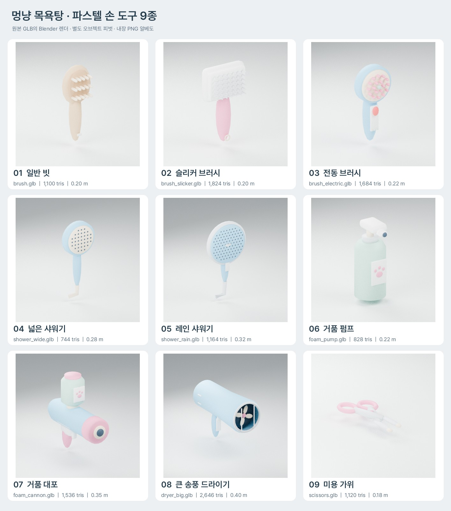

# V4 파스텔 손 도구 9종 납품 — 2026-11-03

기존 `assets/models/tools/shower.glb`, `shampoo.glb`, `dryer.glb`와 `tools/art/build_slots.py`의 말랑한 둥근 프리미티브/팔레트 규칙을 재사용한 신규 자체 제작 자산이다. 게임 실행 코드·기존 기본 도구는 수정하지 않는다.



## 파일과 크기

GLB: `assets/models/tools/`, 개별 640×640 PNG: `art/incoming/tool_upgrades/<같은 파일명>.png`. 미리보기 조명·바닥은 GLB에 들어가지 않는다.

| 파일 | 크기 기준 | 실제 삼각형 | 움직이는 메시 / 축 |
|---|---|---:|---|
| `brush.glb` | Y 0.20 m | 1,100 | — |
| `brush_slicker.glb` | Y 0.20 m | 1,824 | — |
| `brush_electric.glb` | Y 0.22 m | 1,684 | `Head` / Z |
| `shower_wide.glb` | Y 0.28 m | 744 | — |
| `shower_rain.glb` | Y 0.32 m | 1,164 | — |
| `foam_pump.glb` | Y 0.22 m | 828 | `Pump` / Y |
| `foam_cannon.glb` | Z 0.35 m | 1,536 | — |
| `dryer_big.glb` | Z 0.40 m | 2,646 | `Fan` / Z |
| `scissors.glb` | Z 0.18 m | 1,120 | `Blade_L` / Y, `Blade_R` / Y |

## 공통 계약

- glTF 2.0 binary, 미터 단위, Y-up, 작동면/출구는 -Z. 루트 변환은 항등이며 손잡이 쥐는 곳이 원점이다. 가위는 양손잡이 고리 중심의 중간이 원점이다.
- 파일마다 **64×64 PNG 팔레트 한 장이 BIN에 내장**돼 있다. 외부 URI 없음. 정확한 sRGB 색상: #8FD3F4, #FF6B6B, #FF9EC4, #B8E3D3, #E8C9A0, 연한 은색 #DDE5EA, 보조 크림/짙은 출구 색.
- baseColorTexture만 사용. 노멀·AO·metallicRoughness·emissive 텍스처 및 빛 굽기 없음. 기존 강조 효과를 위해 색별 surface 재질을 유지하되 한 내장 팔레트를 공유한다.
- 움직이는 부위는 뼈대/키프레임 없이 실제 메시가 있는 별도 오브젝트다. `Head`/`Fan`: 로컬 Z 회전, `Pump`: 로컬 Y 하강, `Blade_L`/`Blade_R`: 같은 나사 위치에서 로컬 Y 회전. 관절의 정확한 미터 좌표는 `art/incoming/tool_upgrades/artifact_validation.json`에 기록했다.
- 브러시 계열은 원목 굵은 빗살 → 넓은 사각 패드/촘촘한 은색 빗살 → 전동 원형 머리/빨간 버튼/표시등 순으로 구분한다. 넓은/레인 샤워기는 기본보다 큰 판과 많은 출수구, 레인은 은색 테두리로 차별화했다. 민트 펌프보다 거품 대포의 큰 통/몸체/장식을 키웠다.
- 빗살/가위 날 끝은 뭉툭한 모형이다. 출수구는 어두운 내측 색면으로 표현했으며 노멀맵이나 베이크 그림자가 아니다.
- 새 `.glb.import`는 Godot의 내장 이미지 처리 모드 3을 사용한다. GLB 임베디드 PNG를 씬 안의 이미지로 보존해 소스 폴더에 추출 PNG를 추가 납품할 필요가 없다.

## 검증

- 실제 GLB 바이트: 9개 모두 PASS. 파일 헤더, 실제 인덱스 삼각형 수, 유효 면/법선/UV, 크기, 루트·관절 피벗, 이미지 BIN 내장 및 PNG 크기를 검사했다.
- Khronos glTF Validator: 9개 모두 **오류 0 / 경고 0**. 원문: `art/incoming/tool_upgrades/khronos_validation.json`.
- Godot 4.4.1: 9개 PackedScene 로딩, 기존 자동 도구 교체 슬롯, 내장 64px albedo, 각 관절의 독립 이동/회전 확인.
- 전체 게임 회귀 테스트: 최종 **28 통과 / 0 실패**. 로그: `art/incoming/tool_upgrades/qa/full-suite.log`.
- 최초 실행에서는 27 통과 / 1 실패였다. 새 가위 GLB가 생겨 이전에 건너뛰던 그래픽 테스트가 실행되면서, 미구매 상태로 숨긴 가위까지 강조돼야 한다는 전제 오류가 드러났다. 게임 코드를 바꾸지 않고 해당 테스트만 잠금 상태(강조 안 됨)를 확인한 뒤 소유 상태로 전환해 강조를 검사하도록 보정했다. 최초 오류 기록도 `qa/initial-art-regression.log`에 보존했다.
- 최초 headless GLB 임포트에서 엔진의 알려진 dummy texture 썸네일 오류가 발생할 수 있다. 이것은 숨기지 않고 임포트 원본 로그에 보존한다.

미리보기는 Blender에서 렌더한 자산 검토 사진이다. 실제 플레이 화면이나 Windows/Steam Deck 실기 검증 결과로 제시하지 않는다. 부품의 모션 축/독립 이동은 확인하지만 게임 애니메이션 연결 코드를 추가하지 않는다.

## 재생성

```bash
blender -b --factory-startup --python-exit-code 1 --python tools/art/build_v4_tool_upgrades.py
python tools/art/validate_v4_tool_upgrades.py
python tools/art/compose_tool_upgrades.py
godot --headless --path . --import
godot --headless --path . --script tools/art/verify_v4_tool_upgrades.gd
```

사용한 제작 소스와 텍스처는 자체 생성이며 외부 모델·스톡 이미지·유료 자산을 사용하지 않았다. 개별 부품 축과 이름은 사용자의 2026-11-03 명세를 따른다.
