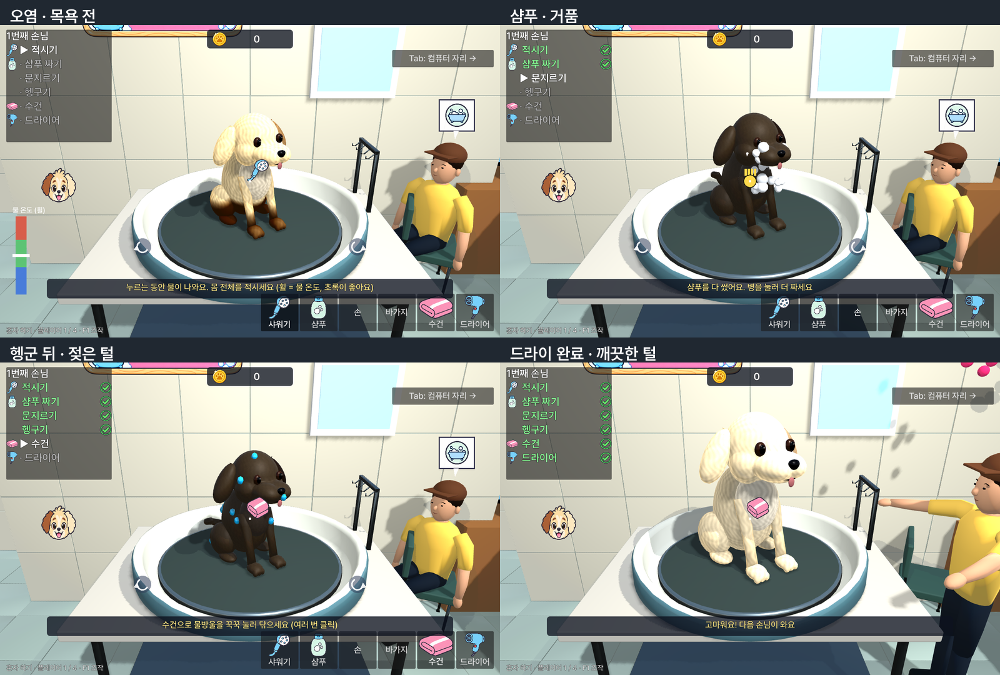
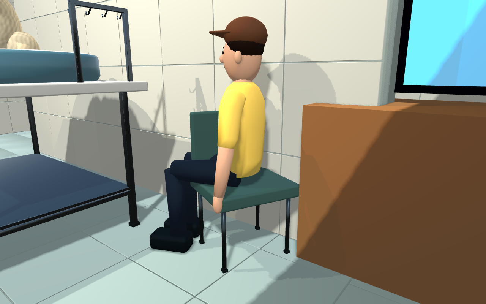

# retail-v2 실제 게임 연결 검수

2026-10-27. Godot 4.4.1에서 직접 제작한 dog → owner → tub → turntable → chair → tiles를 실제 작업대에 연결했다. 6개 슬롯, GLB 7개이며 타일은 바닥·벽 별도다.

## 적용 내용

- `assets/models/`에 납품 GLB를 동일하게 복사하고 기존 교체용 씬에서 참조한다. [파일별 SHA-256](../art/RUNTIME_MANIFEST.json).
- GLB는 명세대로 −Z 정면이다. 게임의 +Z 정면으로 감싸는 씬에서만 180도 돌리고, 관절 회전을 원래 축에 맞춰 커서 추적·걷기·반응 방향을 보정했다.
- 새 주인의 실제 키·말풍선 높이와 앉는 자세를 맞췄다. 추가 무릎 관절로 좌판 높이 0.4m와 발바닥 접지를 검사했다. 몸 전체를 1.4배 늘리던 설정을 제거했다.
- 금속 욕조·고무 회전판·의자·모듈 타일을 배치했다. 조명과 반사·털 밝기를 조정하고, 강아지 알베도 UV 여백에 해당 부위 색을 채워 밉맵의 흰 번짐을 줄였다.
- 털의 오염·거품·젖음·건조 효과와 볼록 클릭 판정을 기존 게임 셰이더·게임 코드로 유지한다. 깨끗한 GLB에 상태 효과를 굽지 않았다.
- HUD에 기존 Pretendard 테마를 명시적으로 전달해 한글과 지정된 글자 크기가 실제 화면에 나타나게 했다.
- 기존 협동 기반과 게임 진행 방식은 유지했다. 게임 수치와 원 제스처 판정 로직은 변경하지 않았다.

## 검증 결과

| 검사 | 결과 |
|---|---|
| GLB 명세·치수·이름·계층·피벗·예산·UV | 7개 PASS |
| Khronos glTF Validator | 7개 오류 0 / 경고 0 |
| 전체 게임·네트워크 테스트 | **14 통과 / 0 실패** |
| 테스트 실행기 자체 검사 | PASS |
| 자동 손동작 목욕 6단계 | 63초 / 목표 65초 |
| 실제 렌더 캡처 | 5장 저장, `RUNTIME_CAPTURE_PASS` |

`tests/game/test_retail_art.tscn`에서 새 GLB 참조, 고개 위/오른쪽 추적, 주인 색상 6개, 좌판/발 접지와 일어서기, 털 메시 16개와 클릭 판정 16개, 알베도 유지, 한글 폰트를 확인한다. 기존 목욕 테스트는 결제·다음 손님까지 실제 조작을 수행한다. ENet 테스트는 다중 클라이언트·작업대 동기화·퇴장·호스트 종료 등을 포함한다. Steam 클라이언트와 실제 Steam 친구 접속은 이 환경에서 확인하지 못했다.

원 그리기 비교 테스트는 이전 간지럼 시험에서 칠해진 마스크를 초기화하고 동일 위치·반경·리듬에서 왕복과 원을 비교하도록 독립시켰다. 원이 왕복보다 두 배 이상 진행되어야 하는 기준은 그대로다.

재실행:

```bash
GODOT=/path/to/Godot_v4.4.1-stable_linux.x86_64 bash tests/selftest.sh
GODOT=/path/to/Godot_v4.4.1-stable_linux.x86_64 bash tests/run_tests.sh
python tools/art/validate_slots.py
NODE_PATH=/path/to/node_modules node tools/art/validate_gltf.cjs art/incoming/*/*.glb
godot --path . tools/art/capture_game.tscn
python tools/art/compose_runtime_previews.py
```

Godot 4.4.1의 headless GLTF 에디터 미리보기에는 [알려진 upstream 결함 #108994](https://github.com/godotengine/godot/issues/108994)이 있다. 임포트 자체가 성공한 뒤 썸네일 저장 중에만 나오는 `texture_2d_get`의 정확한 두 줄을 버전·단계 조건으로 한정해 제외한다. 원본 로그는 `import.raw.log`로 보존하며, 스크립트·셰이더·파싱 오류 및 다른 텍스처 오류는 계속 실패 처리한다. 필터는 `tools/filter_godot_441_import.py`에 있다.

## 실제 게임 화면

다음 화면은 Blender 렌더가 아니라 Godot 4.4.1 실행 화면이다. 1280×800, Xvfb, OpenGL Compatibility / Mesa llvmpipe 소프트웨어 렌더러에서 캡처했다. 하드웨어·렌더러별 최종 표시에는 차이가 있을 수 있다. 상태별 비교를 위해 캡처 도구에서 동일한 난수 시드와 마스크 상태를 설정했다. 목욕 상호작용 자체는 별도 전체 테스트로 검증했다. 앉기 사진만 검수용 카메라이고 나머지는 실제 게임 카메라다.





이번 완료 범위는 새 그래픽의 첫 적용과 실행 검수다. 참고 상용 게임과 같은 최종 제품 품질을 달성했다는 의미는 아니다. [제작·출처 기록](../art/ASSET_PROVENANCE.md)에 외부 시각 참고와 기존 자산의 범위를 남겼다.
